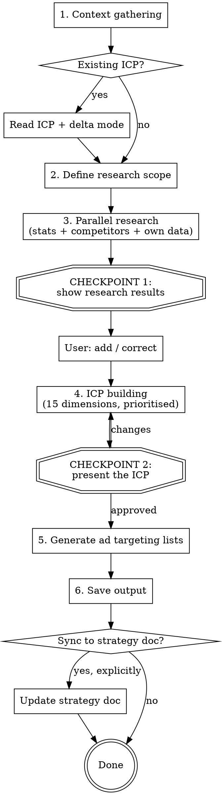

## Step 0: Load the marketing context

Before working with this skill:

1. **Check whether `.agents/product-marketing-context.md` exists** in the current project
2. If YES: read the file and use its positioning, personas, voice and pain points as the
   foundation for your work
3. If NO: ask the user whether they want to run `/product-marketing-context` first, or proceed
   without it (with a warning that results may be less targeted)

# Target Group Intelligence

A systematic research and ICP-building skill. Defines, refines and updates target groups through
parallel research agents with checkpoints.

## Core principle

A target group is more than demographics. Two people with identical age, income and location can
react completely differently to the same campaign. This skill covers 15 dimensions — prioritised
by venture stage rather than all at once.

**Establish the market first.** Ask which country or countries the venture targets and which one
is primary. All research, channels, messaging and cultural considerations must then be grounded
in those markets. Never assume a market — statistics sources, trust signals, regulatory framing
and tone of address all differ by country.

## When to use

- New venture: the first target group definition
- Before ad campaigns: concrete targeting options for Meta, Google and LinkedIn
- After first results: refine with real data (ad performance, interviews, analytics)
- Pivot: reassess the target group after a strategy change
- Kill-switch evaluation: does the target group still fit the hypothesis?

## Workflow



## Phase 1: Context gathering

Gather context before any research:

1. **Identify the venture** — which venture, which stage (opportunity / prototype / pilot)?
2. **Identify the markets** — which countries, which one is primary?
3. **Check for an existing ICP** — is there one already?
4. **Read the strategy source of truth** — hypotheses, status, kill-switch criteria as context
5. **Ask for qualitative data** — "Do you have interview results, survey data, support requests
   or other insights?"
6. **Own ad data** — if available, pull performance data (or suggest `/analyst-report`)

**If an ICP already exists, use delta mode** — do not start from zero. Read it, compare new data
against it, and show the delta.

## Phase 2: Define the research scope

Different emphases by venture stage:

| Stage | Emphasis | Agents |
|-------|----------|--------|
| **Opportunity** (early) | Market size, demographics, competitor targeting | Stats + competitors |
| **Prototype** (first tests) | Own data + competitor comparison + psychographics | All three |
| **Pilot** (scaling) | Own performance data dominates, research supplements | Data + stats |

## Phase 3: Parallel research

Dispatch three research agents simultaneously:

Pass `model: sonnet` and `effort: low` explicitly to these three agents; mid-tier is enough for research. Without it they inherit the main model.

### Agent 1: Stats and market research
- Market size of the target group in the defined markets (primary first, then secondary)
- Demographic data (age, gender, income, education, region)
- Trends and developments in the target market
- Relevant statistics from the national statistics office of each target market, plus Eurostat
  for EU-wide comparisons
- Industry reports and studies

### Agent 2: Competitor and landscape analysis
- Who are the competitors and who do they target?
- What messaging and positioning do they use?
- Which channels are they active on?
- Which audience segments are underserved?
- What form of address (formal or informal, tone, imagery) do they use?

### Agent 3: Own data analysis (if available)
- Ad performance by audience segment (Meta, Google, LinkedIn)
- Website analytics (who arrives, who converts?)
- Include survey and interview results
- Suggest `/analyst-report` if product analytics data exists
- If there is no own data: skip this agent and ask the user for qualitative insights

**CHECKPOINT 1:** present all research results in summary. The user can add, correct and ask
questions. Only continue to ICP building after their go-ahead.

## Phase 4: ICP building — the 15 dimensions

Not all dimensions are equally relevant every time. Prioritise by venture and stage. **Always
cover the core dimensions (1-9). Add the extended dimensions (10-15) as needed.**

### Core dimensions (always cover)

**1. Demographics** — who is this person?
- Age, gender, marital status, children
- Education, occupation and industry, income
- Living situation (urban or rural, renting or owning)

**2. Geography**
- Primary market, expansion markets
- Urban versus rural, regional differences
- Cultural differences within a country and between neighbouring markets — regions within one
  country often differ as much as neighbouring countries do
- Regional differences in tone of address

**3. Psychographics** — why does this person act this way?
- Values and beliefs
- Life goals and aspirations
- Fears and worries
- Self-image and social identity ("I'm a founder", "I'm a widow")
- Risk appetite and openness to new things
- Attitude to technology

**4. Behaviour** — what does this person do?
- Buying behaviour and purchase frequency
- Decision process (impulsive versus research-heavy)
- Online behaviour (search habits, app usage)
- Daily routine
- Payment preferences

**5. Channels and touchpoints** — where do I reach this person?
- Social media (which platforms, how active, consuming versus posting)
- Offline channels (newspapers, radio, TV, outdoor)
- Events, trade fairs, gatherings
- Communities, forums, Facebook groups, WhatsApp groups
- Podcasts (which ones, when)
- Institutions (medical practices, pharmacies, clubs, faith communities, chambers of commerce
  and professional bodies)
- Messaging apps as a direct channel
- Search engines (Google, YouTube)
- Paid versus owned versus earned media mix

**6. Communication and tone** — how do I address this person?
- Formal or informal address? (in languages with a T-V distinction, decide this explicitly)
- Language level: plain or technical?
- Emotional versus rational appeal
- Storytelling versus facts and statistics
- Humour: yes or no, and what kind?
- Cultural sensitivities (stigma around grief, ADHD, menopause, loneliness)
- Imagery: real people versus illustrations, age-appropriate representation

**7. Trust signals** — what creates credibility?
- Social proof (ratings, testimonials, user numbers)
- Expert opinions and clinical endorsement
- Quality marks and certifications (recognise that these are market-specific — pick the ones your
  audience actually knows)
- Media coverage and PR
- Personal recommendations (word of mouth — often the strongest channel with older audiences)
- Transparency (prices, team, processes)
- Data protection signals ("data stays in the EU", GDPR-compliant)
- Money-back guarantee, trial periods, free initial consultation

**8. Objections and barriers** — what holds this person back?
- Price objections and willingness to pay
- Technical barriers (digital literacy, devices)
- Lack of trust
- Lack of time
- Stigma or shame (particularly in health, grief and loneliness ventures)
- Status quo bias ("we manage fine without it")
- Co-deciders (partner, family, a doctor as gatekeeper)
- Bad prior experience with similar offerings

**9. Interests and proxy interests** — what do these people like?
- **Direct interests** — thematically close to the venture
- **Proxy interests** — correlate with the target group without being directly related
  - Hobbies that indicate purchasing power, activity level or mindset
  - Media they consume (newspapers, podcasts, TV shows)
  - Clubs and organisations
  - Lifestyle signals
- **Check targeting availability on Meta, Google and LinkedIn** — not every interest exists as a
  targeting option, and availability differs by country

### Extended dimensions (as needed)

**10. Digital literacy and technology**
- Smartphone usage (heavy, occasional, minimal)
- App versus website versus phone preference
- Video call capability (relevant for telemedicine)
- Data protection sensitivity

**11. Content preferences**
- Video versus text versus audio
- Short form versus long form
- Interactive versus passive
- Affinity for user-generated content
- When they consume content (news in the morning, entertainment in the evening)

**12. Timing and seasonality**
- Life events as triggers (retirement, diagnosis, bereavement, divorce)
- Seasonal shifts in need
- Time of day and day of week for ad scheduling
- Budget cycles (start of the month, start of the year)

**13. Purchase decision dynamics**
- Number of touchpoints before purchase or conversion
- Research behaviour (how many sources?)
- Willingness to trial (does a free trial make sense?)
- Pain versus gain motivation
- Switching costs from the status quo

**14. Competition and alternatives**
- The target group's current solution or status quo
- Known competitors and their positioning
- Substitute behaviours (what does the person do INSTEAD of solving the problem?)
- Willingness to switch

**15. Influencers and community**
- Key opinion leaders in the niche
- Micro-influencers
- Family and partner as co-decision-makers
- Club memberships, volunteering
- Online communities and groups
- Religious or spiritual affiliation (relevant for older audiences)

**CHECKPOINT 2:** present the ICP, structured by the dimensions covered. The user reviews and
approves. If they request changes: adjust and show it again.

## Phase 5: Ad targeting lists

After ICP approval, generate concrete targeting recommendations:

### Meta Ads
- **Direct interests** — thematically close (e.g. entrepreneurship, self-employment)
- **Proxy interests** — correlated but not direct (e.g. golf, non-fiction books, real estate)
- **Recommended ad set structure** (narrow versus broad, which combinations to test)
- **Budget recommendation** per ad set based on the venture budget
- **Lookalike audiences** if there is enough data
- Note: with a small budget, run at most one ad set at a time

### Google Ads
- Keywords (the search intent of the target group)
- Audience segments
- In-market versus affinity audiences

### LinkedIn Ads (if B2B-relevant)
- Job title, seniority, company size
- Skills, groups, interests

### Offline channels (if relevant)
- Concrete suggestions: which events, which media, which institutions
- Partnership options (medical practices, clubs, etc.)

## Phase 6: Output

### Save the ICP document
- Path: `<venture folder>/ICP_<venture>.md`
- Format: structured by the dimensions covered
- Include the ad targeting lists as their own section
- On update: update the existing file (do not create a new one) and document the delta

### Project journal entry
```markdown
## YYYY-MM-DD -- Target group / ICP [created|updated]

**What:** ICP for [venture] [created/refined] based on [sources]
**Why:** [which strategic goal or hypothesis this serves]
**Result:** ICP saved, [X] dimensions covered
**Impact on strategy:** [None / Confirms hypothesis / New segment identified / etc.]
```

### Sync to the strategy source of truth (only on explicit confirmation)
**ALWAYS ask:** "Should I also carry the ICP over into the strategy document?"
- Never write to it automatically
- If yes: a short version under the go-to-market section
- Format: bullet points with bold labels (participant ICP, key barriers, top channels, ad
  targeting, link to the full ICP document)
- Archive existing ICP entries there and replace them with the updated version
- Link to the full ICP document

## Iterative mode

When an ICP already exists and should be updated:

1. Read the existing ICP
2. Identify new data sources (what has changed since last time?)
3. Research only the new or changed aspects
4. **Present the delta:** "Here is what has changed: ..."
5. Write the updated ICP
6. Keep a change history in the ICP document (a short changelog at the end)

## Common mistakes

| Mistake | Better |
|---------|--------|
| Defining only demographics | Psychographics and behaviour are often more decisive |
| Target group too broad | Start narrow, widen later |
| Forgetting proxy interests | The indirect signals are what find new audiences |
| Every dimension at the same depth | Prioritise by stage |
| Treating a multi-country region as homogeneous | Neighbouring markets differ in culture, media and tone — and so do regions within one country |
| Ignoring your own data | From the prototype stage on, your own data beats desk research |
| Creating an ICP once and never updating it | An ICP is alive — refine it after every campaign or interview round |
| Updating the strategy doc automatically | ALWAYS ask first |

## Bidirectional link with product marketing context

This skill and `/product-marketing-context` feed each other:

### Target group → product marketing context
- ICP analysis → section 2 (target audience) and section 3 (personas)
- Pain point research → section 4 (problems and pain points)
- Ad targeting interests → used by `/meta-ads`, `/google-ads`, `/linkedin-ads`

### Product marketing context → target group
- Product overview → refine who benefits most
- Competitive landscape → identify underserved segments
- Customer language → validate ICP hypotheses

### Workflow
1. If no product marketing context exists: run `/target-group` first, then
   `/product-marketing-context`
2. If it exists: use it as input for a deeper `/target-group` analysis
3. After a target group update: sync the changes back to the product marketing context

## Related skills
- `/product-marketing-context` — strategic marketing foundation
- `/customer-discovery` — interview methodology for audience research
- `/competitor-research` — understand competitor audiences
- `/meta-ads` — apply targeting to Meta campaigns
- `/linkedin-ads` — apply targeting to LinkedIn campaigns
