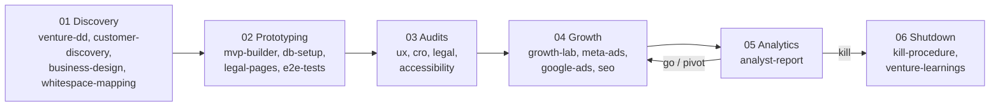
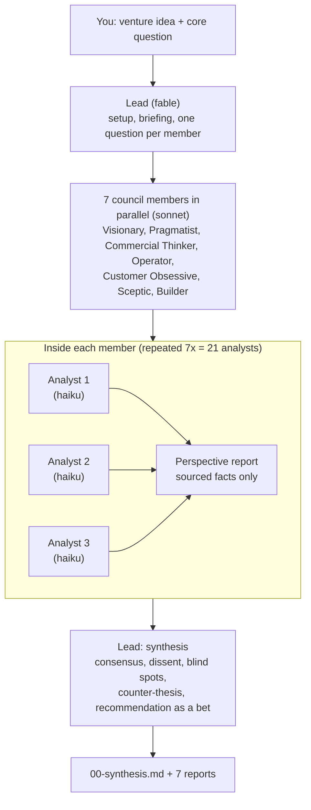

# Venture Building Skills

[Claude Code](https://claude.com/claude-code) skills for building ventures, organized along the venture lifecycle: from first idea to live product to clean shutdown.

Each skill is a reusable instruction package, extracted and generalised from real venture-building work: validating, prototyping and launching multiple products.

## Why this exists

Most new ventures fail in predictable ways: founders build before they have checked that anyone needs the product, run growth experiments without a clear hypothesis, and shut down without learning anything for the next attempt.

These skills turn a venture-building process into repeatable steps that an AI assistant can run with you. The assistant does the legwork (research, structuring, drafting, checklists). You make the decisions.

- **Who it is for:** solo founders, venture builders and product managers who already use Claude Code.
- **What you get:** one skill per step of the lifecycle, so you can pick the step you are on instead of adopting a whole framework.
- **Assumes:** Claude Code or a compatible agent. The prototyping skills assume React and Supabase. The discovery skills use web search, and a few need other tools (see [Requirements](#requirements)).
- **Limits:** the output is decision support, not a decision. Desk research is weak evidence, and the skills label how strong it is. Legal and compliance output are templates that need review by a lawyer in your jurisdiction.
- **Design choices:** a human stays in the loop (interactive skills ask before destructive steps, and the multi-agent council keeps dissent visible instead of averaging it away). Token cost is kept visible: heavy skills only run when you invoke them, and each skill declares a recommended model and effort.

## Quick start

Install one skill, then invoke it:

```bash
git clone https://github.com/elisafabz/Venture-Building-Skills.git
mkdir -p ~/.claude/skills
cp -R Venture-Building-Skills/01-discovery/customer-discovery ~/.claude/skills/
```

Then run `/customer-discovery` in Claude Code. A good first path through the lifecycle:

1. `/venture-dd` - validate the idea with desk research: market, competitors, risks, kill criteria
2. `/mvp-builder` - cut the smallest testable product
3. `/growth-lab` - plan and review your first experiments
4. `/venture-learnings` - capture what you learned if you stop

## Structure



| Folder | Purpose |
|--------|---------|
| `01-discovery/` | Validate the idea before building anything |
| `02-prototyping/` | Build and instrument the first product version |
| `03-audits/` | Quality, legal, and conversion audits before you launch |
| `04-growth/` | Acquire users and grow the product |
| `05-analytics/` | Analyze user behavior and report results |
| `06-shutdown/` | End a venture cleanly and capture the learnings |

## Good to know

- **Recommended model / effort:** each skill's frontmatter sets the model and reasoning effort it works well with. These are recommendations (the cheapest setting that handles the task), not a token budget, and you can override them.
- **Cost:** skills marked **(Heavy)** dispatch many agents or run extensive research and can consume a lot of tokens in one run. They never start automatically (`disable-model-invocation: true`); you have to invoke them explicitly, e.g. `/venture-council`.
- **Stack:** the prototyping skills assume a React + Supabase setup. Discovery, growth, and audit skills are stack-independent.
- **Credentials:** skills that call external APIs (Meta, PostHog) read keys from environment variables. Nothing is stored in this repo.
- **Legal:** the legal and compliance skills are built on EU-level law (GDPR, ePrivacy, e-commerce, consumer rights, MDR). Where a rule comes from a directive rather than a regulation, the skill says so and flags that the national implementation has to be checked. Outputs are templates, not legal advice.

## Skills

### 01-discovery

| Skill | What it does | Recommended model / effort |
|-------|--------------|----------------------------|
| `venture-dd` | **(Heavy)** Structured due diligence for a venture idea: market, competitors, hypotheses, and a written validation report. | `sonnet` / medium |
| `customer-discovery` | Design discovery interviews, generate questions, synthesize insights, refine ICPs, validate pain hypotheses. | `sonnet` / medium |
| `business-design` | Turn an idea into a structured business model: thesis, lean canvas, hypotheses, roadmap, decision matrix. | `sonnet` / medium |
| `competitor-research` | Structured competitor profiles, positioning maps, feature comparisons, and SEO comparison pages. | `sonnet` / medium |
| `target-group` | Define and refine target groups and ICPs via parallel research agents, including ad-targeting proxy interests. | `sonnet` / medium |
| `legal-model-decoder` | Decode how a venture in a regulated market (health, legal, finance) is legally structured - who contracts, bills, and is liable. | `opus` / high |
| `lean-prd` | Write a lean product requirements document for the smallest testable version. | `sonnet` / medium |
| `venture-council` | **(Heavy)** Multi-agent advisory board: a lead, several council members, and research analysts evaluate a venture idea from independent angles. | `fable` / high (lead); members `sonnet`, analysts `haiku` |
| `whitespace-mapping` | **(Heavy)** Find a real whitespace: map both sides of a market (anchor stakeholder and its partners), build problem trees, match the two sides, research startups worldwide by location and funding, and cluster them by solution approach on a Figma board. | `sonnet` / high |

### 02-prototyping

| Skill | What it does | Recommended model / effort |
|-------|--------------|----------------------------|
| `venture-setup` | Interactive checklist for a new project: scaffolding, DB, tracking, legal, SEO, tests - orchestrates the other skills in the right order. | `sonnet` / low |
| `mvp-builder` | Build the smallest functional product version on a modern web boilerplate, with clear cut lines for what NOT to build. | `sonnet` / medium |
| `new-page` | Scaffold a new page with route, lazy loading, SEO meta, and mobile-first layout following project conventions. | `opus` / medium |
| `db-setup` | Scaffold a complete GDPR-compliant session and event tracking system: DB tables, Edge Functions, frontend hooks (Supabase). | `haiku` / low |
| `db-migration` | Generate a Supabase database migration including table definition, RLS policies, triggers, and indexes. | `sonnet` / medium |
| `edge-function` | Scaffold a Supabase Edge Function with auth, CORS, Zod validation, and error handling. | `sonnet` / medium |
| `admin-dashboard` | Scaffold a complete admin KPI dashboard with Supabase Auth, Edge Function, and React frontend. | `opus` / medium |
| `analytics-tracking` | GA4 event architecture, GTM best practices, UTM conventions, and GDPR-compliant tracking with Consent Mode v2. | `sonnet` / medium |
| `setup-gtm` | Set up a Google Tag Manager container with GA4, Meta Pixel, PostHog, Consent Mode v2, and custom events - including hard-won production pitfalls. | `sonnet` / medium |
| `cookie-consent-setup` | End-to-end GDPR-compliant cookie consent: banner, Consent Mode v2, GTM integration, privacy-policy section, compliance audit. | `sonnet` / medium |
| `legal-pages` | Generate GDPR-compliant legal pages (privacy policy, legal notice, terms) for the EU with automatic third-party tool detection - company data via placeholders. | `opus` / high |
| `exit-intent-survey` | Generate an exit-intent survey: detection hook, UI component, edge function, and DB migration. | `sonnet` / medium |
| `bot-prevention` | Protect forms and endpoints from bots and abuse. | `sonnet` / medium |
| `e2e-tests` | Generate Playwright end-to-end tests for a page or feature, following project conventions. | `sonnet` / low |
| `security-audit` | Scan a project for hardcoded secrets, missing RLS, direct DB access from the frontend, XSS risks, and more. | `fable` / xhigh |
| `pre-deploy` | Pre-deployment checklist and verification. | `opus` / high |
| `posthog-dashboard` | Create PostHog dashboards, insights, cohorts, and annotations via API - including bot-filtering learnings from production. | `sonnet` / low |

### 03-audits

| Skill | What it does | Recommended model / effort |
|-------|--------------|----------------------------|
| `ux-audit` | Audit UX against established UX laws, cognitive principles, and Nielsen's heuristics. | `sonnet` / medium |
| `ui-audit` | Audit visual UI quality: hierarchy, spacing, typography, color, consistency. | `sonnet` / medium |
| `cro-audit` | Audit conversion optimization: messaging clarity, trust placement, funnel flow, persuasion structure. | `sonnet` / medium |
| `mobile-audit` | Audit mobile optimization: Core Web Vitals, responsive design, touch targets, performance. | `sonnet` / medium |
| `accessibility-audit` | Audit and fix accessibility issues against WCAG 2.2 Level AA. | `sonnet` / medium |
| `legal-audit` | Audit website legal compliance for the EU: GDPR, e-commerce information duties, consumer rights, cookie consent, accessibility. | `opus` / high |
| `health-claims-audit` | Audit health and medical product claims against EU regulation (MDR, health claims regulation, cosmetics regulation). | `opus` / high |

### 04-growth

| Skill | What it does | Recommended model / effort |
|-------|--------------|----------------------------|
| `product-marketing-context` | Create the central product marketing context document all other marketing skills build on: positioning, personas, competitive landscape, brand voice. | `sonnet` / medium |
| `growth-strategy` | Choose which growth channels and strategies to pursue. | `sonnet` / medium |
| `growth-lab` | Plan, log, and review growth experiments with ICE scoring, a testing hierarchy, kill/scale rules, and JSON-based tracking. | `sonnet` / medium |
| `google-ads` | Google Ads setup and optimization: Search, Display, Performance Max, keyword strategy, Quality Score, bidding. | `sonnet` / medium |
| `linkedin-ads` | LinkedIn Ads for B2B: job-title and seniority targeting, Sponsored Content, Lead Gen Forms. | `sonnet` / medium |
| `meta-ads` | Full Meta (Facebook/Instagram) ad workflow: strategy, hooks, copy, creatives, campaign deployment scripts, and hard-won Marketing API pitfalls. | `sonnet` / medium |
| `meta-social-images` | Facebook/Instagram profile pictures and cover images for a brand, generated from brand guidelines. | `sonnet` / low |
| `content-marketing` | Content strategy: types, formats, distribution, repurposing matrix, funnel mapping, editorial calendar. | `sonnet` / medium |
| `email-marketing` | Email strategy: onboarding sequences, campaigns, deliverability (SPF/DKIM/DMARC), content mix. | `sonnet` / medium |
| `linkedin-content-writer` | Write organic LinkedIn content. | `sonnet` / medium |
| `seo` | Search engine optimization strategy and implementation. | `sonnet` / medium |
| `pricing-strategy` | Pricing models (subscription, freemium, usage-based), tier design, anchoring, discount marketing. | `opus` / high |
| `brand-identity` | Interactive brand identity workshop: inspiration, personality, colors, assets, logo, website. | `sonnet` / medium |
| `social-sharing` | Generate OG preview image, favicon, meta tags, and social sharing assets from brand guidelines. | `sonnet` / low |

### 05-analytics

| Skill | What it does | Recommended model / effort |
|-------|--------------|----------------------------|
| `analyst-report` | Generate a structured PDF analyst report on user behavior: traffic, campaigns, funnel, user profiles, and actionable recommendations (Supabase + Meta Marketing API). | `sonnet` / medium |

### 06-shutdown

| Skill | What it does | Recommended model / effort |
|-------|--------------|----------------------------|
| `kill-procedure` | Systematic venture shutdown: documentation, wiki updates, service deactivation, data archiving (including a proven PostHog export script) - interactive, asks before each step, never deletes. | `sonnet` / medium |
| `venture-learnings` | Generate a structured post-mortem learnings document (and PDF) when a venture is shut down or paused - so the next venture starts smarter. | `sonnet` / medium |

## How `venture-council` works

> **Caution: this is the heaviest skill in the repo.** One run dispatches about 28 agents (1 lead, 7 council members, 21 analysts) with extensive web research, and can consume a very large number of tokens. It never starts automatically: you have to invoke `/venture-council` yourself. Check your plan limits or API budget first, use it for decisions that justify the cost, and for a lighter check start with `venture-dd`.

One lead briefs seven council members in parallel. Each member dispatches three research analysts, writes a perspective report, and the lead synthesizes all seven reports with dissent kept visible.



**Why this setup**

- **Independent angles:** each member answers one question from one perspective (growth, feasibility, money, operations, customer, risk, build effort), so no single viewpoint dominates the analysis.
- **Dissent stays visible:** disagreement between members is reported, not averaged away. The design follows *Thinking in Bets* (Annie Duke) and *The Venture Mindset* (Strebulaev/Dang), where a single well-argued conviction can outweigh the average.
- **Sourced facts only:** analysts must use web search, and anything they cannot find is marked "no reliable data found" instead of invented.
- **Cost where it matters:** the expensive model only briefs and synthesizes, mid-tier models write the perspectives, and the cheapest model does the research.
- **Decision as a bet:** the recommendation comes with confidence percentages and a deliberate search for the strongest counter-thesis, so it reads as decision support, not a verdict.

## Requirements

Most skills work with Claude Code alone. These need extra tools or access:

| Skill | Needs |
|-------|-------|
| `whitespace-mapping` | Figma MCP (FigJam board); web search for the research agents |
| `venture-dd` | Web search |
| `venture-council` | Web search and web fetch |
| `competitor-research` | Web fetch; Firecrawl optional |
| `growth-lab` | Web search optional (live benchmarks) |
| `brand-identity` | Web fetch optional (inspiration links) |
| `meta-ads` | Meta Marketing API access token; the meta-ads MCP is optional (it cannot create ad sets, see the skill) |
| `analyst-report` | Supabase access; Meta Marketing API (MCP or REST) for ad data |
| `posthog-dashboard` | PostHog MCP or a PostHog API key |
| `kill-procedure` | PostHog MCP or a PostHog API key for the data export |

The prototyping skills (`db-setup`, `db-migration`, `edge-function`, `admin-dashboard`, and others) assume a Supabase project.

## Install

Skills live in `~/.claude/skills/<name>/SKILL.md`. Copy only the ones you need, since every installed skill adds to Claude's context:

```bash
cp -R Venture-Building-Skills/04-growth/growth-lab ~/.claude/skills/
```

Or install a whole stage at once:

```bash
cp -R Venture-Building-Skills/03-audits/* ~/.claude/skills/
```

## Acknowledgements

The `google-ads`, `content-marketing`, `email-marketing`, and `pricing-strategy` skills are based in part on [kostja94/marketing-skills](https://github.com/kostja94/marketing-skills) (MIT), extended and reworked. The `seo`, `linkedin-ads`, and `growth-strategy` skills were inspired by the same project and share little text with it.

## License

MIT
